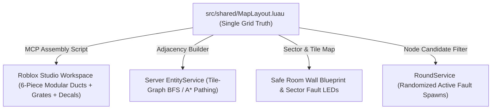

# Technical Architecture & Roblox DataModel Contract

> **Workspace:** `c:\Users\kamish76\Desktop\Dev Projects\roblox-project`  
> **Studio Place:** `Kamish_76's Place: 11192026_1` (`placeId: 119329366233303`, `universeId: 10777845276`)  
> **Toolchain:** Rokit `1.2.0` · Rojo `7.7.1` · `Roblox_Studio` MCP

---

## 1. Source-of-Truth & Rojo Mapping

Per [ADR-001](./DECISIONS.md#adr-001-split-source-of-truth-between-rojo-src-and-roblox-studio-mcp), code and spatial assets are strictly separated so Git holds clean Luau source and Studio holds 3D geometry/lighting/audio without overwriting each other.

### Current [default.project.json](../default.project.json) Mappings
All parent services use `"$ignoreUnknownInstances": true`:
* `src/shared` → `ReplicatedStorage.Shared`
* `src/server` → `ServerScriptService.Server`
* `src/client` → `StarterPlayer.StarterPlayerScripts.Client`
* `src/character/Animate.client.luau` → `StarterPlayer.StarterCharacterScripts.Animate`
* **Studio-Owned Starter Character:** `StarterPlayer.StarterCharacter` (R6 Vent Technician jumpsuit rig; preserved via `"$ignoreUnknownInstances": true` per [ADR-008](./DECISIONS.md#adr-008-enforce-r6-vent-technician-rig-via-starterplayerstartercharacter--unified-lighting-lightingstylerealistic))

### Current Repository Baseline (`src/`)
* [src/shared/GameConfig.luau](../src/shared/GameConfig.luau) — Shared Safe Room & crawl physics, headlamp optics, and modular vent kit dimensions (`[Exists]`)
* [src/shared/MapLayout.luau](../src/shared/MapLayout.luau) — Single 1:1 grid blueprint (`33` tiles, `4` sectors `A`–`D` + `HUB`, `8` repair slots, `5` grates, BFS pathing & `validate()`) (`[Exists]`)
* [src/shared/NetContracts.luau](../src/shared/NetContracts.luau) — Canonical remote, `CollectionService` tag, attribute, and `CollisionGroup` names (`[Exists]`)
* [src/shared/EntityProfiles.luau](../src/shared/EntityProfiles.luau) — Modular `EntityProfile` registry (`JointCracker` active MVP, `ClickingCrawler` queued v0.2) (`[Exists]`)
* [src/server/init.server.luau](../src/server/init.server.luau) — Server entry point validating `MapLayout` and bootstrapping `PlayerStateService` (`[Exists]`)
* [src/server/PlayerStateService.luau](../src/server/PlayerStateService.luau) — Standing/crawl stance switching, `DropShaft` prompts, `CollisionGroup`s, Safe Room spawn clamp, and `HeadlampToggled` authority (`[Exists]`)
* [src/character/Animate.client.luau](../src/character/Animate.client.luau) — Custom `StarterCharacterScripts.Animate` override (`[Exists]`)
* [src/client/init.client.luau](../src/client/init.client.luau) — Client entry point (`[Exists]`)
* [src/client/CrawlController.luau](../src/client/CrawlController.luau) — `LockFirstPerson`, stance-aware eye height & speeds, and procedural R6 Motor6D standing/crawl poses (`[Exists]`)
* [src/client/HeadlampController.luau](../src/client/HeadlampController.luau) — Camera-tracked `SpotLight` rig, `[F]` toggle, and co-op teammate beams (`[Exists]`)

### Planned Module Topology (Target Architecture)
*(Items marked `[Exists]` shipped in M1–M2; `[Planned]` modules ship incrementally across `M3`–`M5`.)*

```text
src/
├── shared/
│   ├── MapLayout.luau        [Exists]  1:1 grid blueprint, tile connections, sectors, node slots, BFS & validate()
│   ├── EntityProfiles.luau   [Exists]  Modular EntityProfile definitions (v0.1 JointCracker -> v0.2 roster)
│   ├── GameConfig.luau       [Exists]  Safe Room & crawl speeds, headlamp optics, vent dimensions
│   └── NetContracts.luau     [Exists]  Canonical Remote names, Tags, Attributes & CollisionGroup constants
├── character/
│   └── Animate.client.luau   [Exists]  Overrides default R6 Animate; supports optional CustomCrawlAnimationId
├── server/
│   ├── init.server.luau      [Exists]  Server entry point, MapLayout.validate() & service bootstrap
│   ├── RoundService.luau     [Planned] Contract lifecycle, node randomization, Partial/Full Sign-Off XP
│   ├── RepairService.luau    [Planned] ProximityPrompt validation, interruptible progress, spark noise events
│   ├── EntityService.luau    [Planned] Tile-Graph A*/BFS patrol, sight/noise aggro, hunt/attack state machine
│   └── PlayerStateService.luau [Exists] Stance switching, DropShaft prompts, CollisionGroups & headlamp server state
└── client/
    ├── init.client.luau     [Exists]  Client entry point
    ├── CrawlController.luau  [Exists]  LockFirstPerson, disabled jump, standing/crawl speeds & procedural R6 poses
    ├── HeadlampController.luau [Exists] Camera-tracked SpotLight rig, [F] toggle remote, co-op teammate beams
    ├── PanicController.luau  [Planned] Stale air / panic breathing meter & audio feedback
    └── SafeRoomUI.luau       [Planned] Work Order clipboard & client visual sync with Studio blueprint/LEDs
```

---

## 2. Shared `MapLayout.luau` 1:1 Pipeline

Per [ADR-002](./DECISIONS.md#adr-002-drive-studio-geometry-ai-graph-safe-room-blueprint--node-spawns-from-shared-maplayoutluau), one deterministic grid definition feeds every spatial system so Studio visuals, AI navigation, and Safe Room maps can never go out of sync:



---

## 3. Contracts Registry (Living Interface Tables)

> **Rule:** Every `RemoteEvent`, `RemoteFunction`, `CollectionService` tag, Instance `Attribute`, and `CollisionGroup` added to code or Roblox Studio **must** be registered here before merging.

### 3.1 Network Remotes (`ReplicatedStorage.Remotes`)
*Implemented in M1: `HeadlampToggled`; remaining items are milestone targets.*

| Name | Kind | Direction | Payload | Server Validation | Status |
| :--- | :--- | :--- | :--- | :--- | :--- |
| `HeadlampToggled` | `RemoteEvent` | Client → Server → Clients | `isOn: boolean` (Server broadcasts `player, isOn`) | `typeof(isOn) == "boolean"`, `0.25s` cooldown; sets `HeadlampOn` attribute | `Implemented (M1)` |
| `NoiseEmitted` / Server Event | Server Internal / Optional | Client → Server | `{ noiseType: "Crawl" \| "Gasp" }` | Rate-limited; server validates player position & distance rather than trusting raw coordinates | `Planned (M4)` |
| `WorkOrderSignOff` | `RemoteEvent` | Client → Server | `{ deductionId: string? }` | Verify player is alive inside Safe Room zone and contract is active | `Planned (M3)` |
| `RoundStateSync` | `RemoteEvent` | Server → All Clients | `{ phase: string, activeSectors: {string}, repairedCount: number, requiredCount: number }` | Authoritative server broadcast | `Planned (M3)` |
| `PanicStateSync` | `RemoteEvent` | Server ↔ Client | `{ panicRatio: number }` | Server clamps rate based on darkness/movement | `Planned (M4)` |

### 3.2 `CollectionService` Tags
*Implemented in M2 across `Workspace.VentMap`: `VentTile` (33), `RepairNode` (8), `SectorLED` (4), `SafeRoomZone` (1), `FloorGrate` (5).*

| Tag | Applied To | Owner | Purpose | Status |
| :--- | :--- | :--- | :--- | :--- |
| `VentTile` | Modular duct root `Model`s | Studio (MCP) | Identifies grid tiles with `GridX`, `GridZ`, `Sector`, `TileType` attributes | `Implemented (M2)` |
| `RepairNode` | Fault box `Model`s (`RepairNode_A1..D2`) | Studio (MCP) | Candidate spawn locations (`M3` attaches `ProximityPrompt` & sparking VFX) | `Implemented (M2)` |
| `SectorLED` | Safe Room annunciator parts | Studio (MCP) | Lights up per `Sector` when active faults exist in that zone | `Implemented (M2)` |
| `SafeRoomZone` | Safe Room volume `BasePart` | Studio (MCP) | Marks extraction boundary for Work Order Sign-Off eligibility & panic recovery | `Implemented (M2)` |
| `FloorGrate` | Grate peephole assemblies | Studio (MCP) | Landmark lighting openings looking into colored silhouette pits below | `Implemented (M2)` |

### 3.3 Instance `Attribute`s
*Implemented across M1–M2: `HeadlampOn`, `InSafeRoom`, `IsCrawling`, `GridX`/`GridZ`, `Sector`, `TileType`, `NodeId`, and standby repair attributes.*

| Attribute | Host Instance | Type | Values / Range | Consumer | Status |
| :--- | :--- | :--- | :--- | :--- | :--- |
| `GridX` / `GridZ` | `VentTile` & `RepairNode` Models | `number` | Integer tile coords | `MapLayout` validator / AI | `Implemented (M2)` |
| `Sector` | `VentTile` / `RepairNode` / `SectorLED` / `FloorGrate` | `string` | `"A" \| "B" \| "C" \| "D" \| "HUB"` | `RoundService` & Blueprint | `Implemented (M2)` |
| `TileType` | `VentTile` Model | `string` | `"Straight" \| "Corner" \| "TJunction" \| "Cross" \| "Alcove" \| "DropShaft"` | Studio validation | `Implemented (M2)` |
| `NodeId` | `RepairNode` Model | `string` | `"A1".."D2"` | `RoundService` & Blueprint | `Implemented (M2)` |
| `IsActiveFault` | `RepairNode` Model | `boolean` | `true \| false` (`false` standby in M2) | `RepairService` & VFX | `Standby (M2) -> Active (M3)` |
| `IsRepaired` | `RepairNode` Model | `boolean` | `true \| false` | `RepairService` & `RoundService` | `Standby (M2) -> Active (M3)` |
| `RepairProgress` | `RepairNode` Model | `number` | `0.0` .. `1.0` | `RepairService` (interruptible checkpoints) | `Standby (M2) -> Active (M3)` |
| `HeadlampOn` | `Player` | `boolean` | `true \| false` | `HeadlampController` & Server `EntityService` | `Implemented (M1)` |
| `InSafeRoom` | `Player` | `boolean` | `true \| false` | `PlayerStateService` & `M3` Work Order Sign-Off | `Implemented (M2)` |
| `IsCrawling` | `Player` | `boolean` | `true \| false` | `CrawlController` & `PlayerStateService` | `Implemented (M2)` |

### 3.4 `CollisionGroup` Matrix
*Configured in Studio and `PlayerStateService`: `Crawlers`, `VentWalls`.*

| Group Name | Collides With | Does Not Collide With | Purpose | Status |
| :--- | :--- | :--- | :--- | :--- |
| `Crawlers` | `Default`, `VentWalls` | `Crawlers` | Lets 1–4 players share cramped `4.6`-stud ducts without body-block griefing | `Implemented (M1)` |
| `VentWalls` | `Default`, `Crawlers`, `Entity` | — | Structural modular vent shells & floor grates | `Implemented (M1)` |
| `Entity` | `VentWalls` (or graph-driven) | `Crawlers` (uses distance/LOS check) | Prevents entity physics snagging against players or tight corner seams | `Planned (M4)` |

---

## 4. Critical Roblox Engine Guardrails

1. **R6 Crawl Hitbox, Camera Offset & Enclosed Spawning (`M1`):**
   * Roblox animations are **purely visual** and do not shrink `BasePart` physics bounds.
   * Lower `Humanoid.HipHeight` (`-1.6`) and set R6 non-root limbs (`Arms`/`Legs`) `CanCollide = false` so the character clears `4.2`-stud ceilings cleanly without snagging.
   * Roblox's built-in R6 first-person camera adds `+1.5Y` above `HumanoidRootPart`; set `GameConfig.Crawl.BaseCameraOffset = Vector3.new(0, -1.20, 0)` so eye level sits inside the prone `Head` (`Y ≈ 5.84` vs floor `4.0`).
   * Disable jumping (`Humanoid:SetStateEnabled(Enum.HumanoidStateType.Jumping, false)` and `JumpPower = 0`), lock `CameraMode = Enum.CameraMode.LockFirstPerson`, and replace `StarterCharacterScripts.Animate` (`src/character/Animate.client.luau`) with procedural `Motor6D.Transform` updates in `RunService.Stepped`.
   * **Enclosed Spawn Clamp:** `SpawnLocation` inside a `4.2`-stud duct pushes spawns onto the ceiling (`Y = 10.20`); `PlayerStateService` detects roof-pushed spawns and pivots characters inside `TestSpawn` (`Y = 5.40`).
2. **Headlamp Rigging & Server Authority (`M1`):**
   * `SpotLight` instances do **not** render directly inside `Workspace.CurrentCamera`.
   * Parent `Beam` + `Fill` `SpotLight`s to an invisible, non-colliding `Workspace._LocalClientVFX.LocalHeadlampRig` updated every `RunService.RenderStepped` (exponentially damped angular lag), and render remote teammates' `TeammateHeadlamp` `SpotLight`s on their `Head`s.
   * Always notify the server via `HeadlampToggled` so `EntityService` evaluates beam exposure authoritatively on the server.
3. **Pitch-Black Lighting, `SurfaceGui` Orientation & Map Invariants (`M1`/`M2`):**
   * Configure Unified Lighting (`Lighting.LightingStyle = Enum.LightingStyle.Realistic`, `PrioritizeLightingQuality = true`; legacy `Enum.LightingTechnology` is not present in this Studio build) with `Ambient = 0`, `OutdoorAmbient = 0`, `Brightness = 0`, `ClockTime = 0`, and `EnvironmentDiffuseScale = 0`.
   * Enforce `>= 0.5` stud wall/roof thickness (`0.6` stud shells + `1.7` stud solid corners across `VentMap`) to eliminate dynamic light bleed.
   * **`SurfaceGui` Wall Boards:** Orient North-wall Safe Room boards by rotating the carrier `Part` `180°` around Y (`CFrame.Angles(0, math.pi, 0)`), binding `Face = Enum.NormalId.Front`, explicit `Adornee = part`, and `LightInfluence = 0` so `BlueprintGui` and `AnnunciatorGui` render crisply facing `+Z` in true compass alignment (`-X` left, `+X` right).
   * **`MapLayout.validate()` Invariant:** Server startup asserts `100%` seam symmetry, zero non-`Alcove` dead ends, `100%` BFS reachability from `DropShaft (0,0)`, and `2` repair slots per sector (`A`–`D`).
4. **Tile-Graph AI Over `PathfindingService` (`M4`):**
   * `PathfindingService` navmeshes reliably break or stall inside narrow `4.5`-stud tunnels.
   * Build `EntityService` directly atop the `MapLayout.luau` adjacency graph using deterministic BFS/A* tile transitions and smooth `CFrame`/tween interpolation between node centers.
