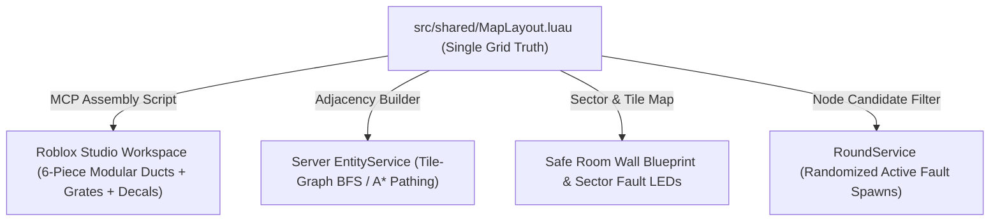

# Technical Architecture & Roblox DataModel Contract

> **Workspace:** `c:\Users\kamish76\Desktop\Dev Projects\roblox-project`  
> **Studio Place:** `Kamish_76's Place: 11192026_1` (`placeId: 119329366233303`, `universeId: 10777845276`)  
> **Toolchain:** Rokit `1.2.0` · Rojo `7.7.1` · `Roblox_Studio` MCP

---

## 1. Source-of-Truth & Rojo Mapping

Per [ADR-001](./DECISIONS.md#adr-001-split-source-of-truth-between-rojo-src-and-roblox-studio-mcp), code and spatial assets are strictly separated so Git holds clean Luau source and Studio holds 3D geometry/lighting/audio without overwriting each other.

### Current [default.project.json](../default.project.json) Mappings
All parent services use `"$ignoreUnknownInstances": true`:
* `src/shared` → `ReplicatedStorage.Shared`
* `src/server` → `ServerScriptService.Server`
* `src/client` → `StarterPlayer.StarterPlayerScripts.Client`

### Current Repository Baseline (`src/`)
* [src/client/init.client.luau](../src/client/init.client.luau) — Client bootstrap stub (`[Exists]`)
* [src/server/init.server.luau](../src/server/init.server.luau) — Server bootstrap stub requiring `ReplicatedStorage.Shared.Hello` (`[Exists]`)
* [src/shared/Hello.luau](../src/shared/Hello.luau) — Shared stub module (`[Exists]`)

### Planned Module Topology (Target Architecture)
*(Items marked `[Planned]` will be created incrementally across milestones `M1`–`M5`.)*

```text
src/
├── shared/
│   ├── MapLayout.luau        [Planned] 1:1 grid blueprint, tile connections, sectors, node slots
│   ├── EntityProfiles.luau   [Planned] Modular EntityProfile definitions (v0.1 -> v0.2 roster)
│   ├── GameConfig.luau       [Planned] Crawl speeds, headlamp ranges, panic rates, XP payout rules
│   └── NetContracts.luau     [Planned] Canonical Remote names & payload type definitions
├── server/
│   ├── init.server.luau      [Exists]  Server entry point & round coordinator bootstrap
│   ├── RoundService.luau     [Planned] Contract lifecycle, node randomization, Partial/Full Sign-Off XP
│   ├── RepairService.luau    [Planned] ProximityPrompt validation, interruptible progress, spark noise events
│   ├── EntityService.luau    [Planned] Tile-Graph A*/BFS patrol, sight/noise aggro, hunt/attack state machine
│   └── PlayerStateService.luau [Planned] R6 crawl hitbox setup, headlamp server state, panic/alive tracking
└── client/
    ├── init.client.luau     [Exists]  Client entry point
    ├── CrawlController.luau  [Planned] LockFirstPerson, disabled jump, reverse crawl speed, custom R6 Animate override
    ├── HeadlampController.luau [Planned] Camera-tracked SpotLight attachment, toggle remote, proximity flicker
    ├── PanicController.luau  [Planned] Stale air / panic breathing meter & audio feedback
    └── SafeRoomUI.luau       [Planned] Work Order clipboard & client visual sync with Studio blueprint/LEDs
```

---

## 2. Shared `MapLayout.luau` 1:1 Pipeline

Per [ADR-002](./DECISIONS.md#adr-002-drive-studio-geometry-ai-graph-safe-room-blueprint--node-spawns-from-shared-maplayoutluau), one deterministic grid definition feeds every spatial system so Studio visuals, AI navigation, and Safe Room maps can never go out of sync:



---

## 3. Contracts Registry (Living Interface Tables)

> **Rule:** Every `RemoteEvent`, `RemoteFunction`, `CollectionService` tag, Instance `Attribute`, and `CollisionGroup` added to code or Roblox Studio **must** be registered here before merging.

### 3.1 Network Remotes (`ReplicatedStorage.Remotes`)
*Currently implemented in `src/`: **None yet** (milestone targets listed below).*

| Name | Kind | Direction | Payload | Server Validation | Status |
| :--- | :--- | :--- | :--- | :--- | :--- |
| `HeadlampToggled` | `RemoteEvent` | Client → Server → Clients | `{ isOn: boolean }` | Clamp toggle cooldown; reject if dead/in Safe Room if applicable; store authoritative state on server | `Planned (M1)` |
| `NoiseEmitted` / Server Event | Server Internal / Optional | Client → Server | `{ noiseType: "Crawl" \| "Gasp" }` | Rate-limited; server validates player position & distance rather than trusting raw coordinates | `Planned (M4)` |
| `WorkOrderSignOff` | `RemoteEvent` | Client → Server | `{ deductionId: string? }` | Verify player is alive inside Safe Room zone and contract is active | `Planned (M3)` |
| `RoundStateSync` | `RemoteEvent` | Server → All Clients | `{ phase: string, activeSectors: {string}, repairedCount: number, requiredCount: number }` | Authoritative server broadcast | `Planned (M3)` |
| `PanicStateSync` | `RemoteEvent` | Server ↔ Client | `{ panicRatio: number }` | Server clamps rate based on darkness/movement | `Planned (M4)` |

### 3.2 `CollectionService` Tags
*Currently applied in Studio: **None yet**.*

| Tag | Applied To | Owner | Purpose | Status |
| :--- | :--- | :--- | :--- | :--- |
| `VentTile` | Modular duct root `Model`s | Studio (MCP) | Identifies grid tiles with `GridX`, `GridZ`, `Sector`, `TileType` attributes | `Planned (M2)` |
| `RepairNode` | Fault box / valve `Model`s | Studio (MCP) | Candidate spawn locations holding `ProximityPrompt` and sparking VFX | `Planned (M3)` |
| `SectorLED` | Safe Room annunciator parts | Studio (MCP) | Lights up per `Sector` when active faults exist in that zone | `Planned (M2)` |
| `SafeRoomZone` | Safe Room volume `BasePart` | Studio (MCP) | Marks extraction boundary for Work Order Sign-Off eligibility & panic recovery | `Planned (M2/M3)` |
| `FloorGrate` | Grate peekhole assemblies | Studio (MCP) | Landmark lighting openings looking into silhouette rooms below | `Planned (M2)` |

### 3.3 Instance `Attribute`s
*Currently applied in Studio: default Lighting migration attributes only.*

| Attribute | Host Instance | Type | Values / Range | Consumer | Status |
| :--- | :--- | :--- | :--- | :--- | :--- |
| `GridX` / `GridZ` | `VentTile` Model | `number` | Integer tile coords | `MapLayout` validator / AI | `Planned (M2)` |
| `Sector` | `VentTile` / `RepairNode` / `SectorLED` | `string` | `"A" \| "B" \| "C" \| "D"` | `RoundService` & Blueprint | `Planned (M2)` |
| `IsActiveFault` | `RepairNode` Model | `boolean` | `true \| false` | `RepairService` & VFX | `Planned (M3)` |
| `IsRepaired` | `RepairNode` Model | `boolean` | `true \| false` | `RepairService` & `RoundService` | `Planned (M3)` |
| `RepairProgress` | `RepairNode` Model | `number` | `0.0` .. `1.0` | `RepairService` (interruptible checkpoints) | `Planned (M3)` |
| `HeadlampOn` | `Player` | `boolean` | `true \| false` | Server `EntityService` | `Planned (M1)` |

### 3.4 `CollisionGroup` Matrix
*Currently configured in Studio: Default only.*

| Group Name | Collides With | Does Not Collide With | Purpose | Status |
| :--- | :--- | :--- | :--- | :--- |
| `Crawlers` | `Default`, `VentWalls` | `Crawlers` | Lets 1–4 players share cramped `4.5`-stud ducts without body-block griefing | `Planned (M1/M3)` |
| `Entity` | `VentWalls` (or graph-driven) | `Crawlers` (uses distance/LOS check) | Prevents entity physics snagging against players or tight corner seams | `Planned (M4)` |

---

## 4. Critical Roblox Engine Guardrails

1. **R6 Crawl Hitbox & Camera Rig (`M1`):**
   * Roblox animations are **purely visual** and do not shrink `BasePart` physics bounds.
   * Lower `Humanoid.HipHeight` and adjust R6 torso/limb `CanCollide` / capsule bounds so the character cleanly clears `4.0–4.5` stud ceilings without snagging.
   * Disable jumping (`Humanoid:SetStateEnabled(Enum.HumanoidStateType.Jumping, false)` and `JumpPower = 0`), set `CameraMode = Enum.CameraMode.LockFirstPerson`, lower `Humanoid.CameraOffset` to prone eye level, and replace/override the default R6 `Animate` script with custom crawl animations.
2. **Headlamp Rigging & Server Authority (`M1`):**
   * `SpotLight` instances do **not** render directly inside `Workspace.CurrentCamera`.
   * Parent the `SpotLight` to an invisible, non-colliding `Part` or `Attachment` updated every `RunService.RenderStepped` (with slight damped angular lag for handheld/helmet weight).
   * Always notify the server via `HeadlampToggled` so `EntityService` evaluates beam exposure authoritatively on the server.
3. **Pitch-Black Lighting Discipline (`M1`/`M2`):**
   * Configure `Lighting` (`Future` / Unified Lighting) with near-zero `Ambient`, `OutdoorAmbient`, and `Brightness` inside interior duct geometry.
   * Enforce `>= 0.5` stud wall/roof thickness on every modular prefab and overlapping corner seams to stop dynamic light bleed.
4. **Tile-Graph AI Over `PathfindingService` (`M4`):**
   * `PathfindingService` navmeshes reliably break or stall inside narrow `4.5`-stud tunnels.
   * Build `EntityService` directly atop the `MapLayout.luau` adjacency graph using deterministic BFS/A* tile transitions and smooth `CFrame`/tween interpolation between node centers.
